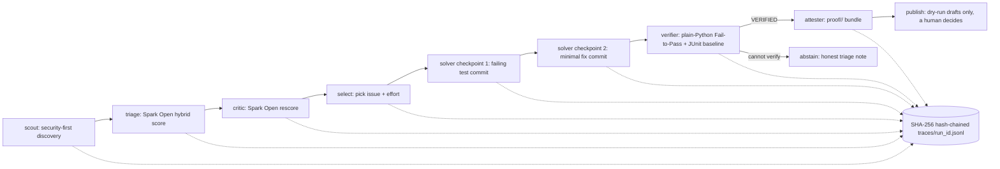

# ISSA AS — Issue Scouting, Solving & Attestation, Agentic Solver

> **Autonomous Security-First GitHub Issue Scout, Multi-Model Triage Router, and Deterministic Fail-to-Pass Repair Agent powered by Meta Muse Spark.**

[](https://github.com/Ataraxiainc2/ISSAAS/actions/workflows/ci.yml)

## Meta Global AI Hackathon 2026 — Submission Overview

- **Track**: Indie Developer (solo) · **Problem statement**: **Push the Frontier** — autonomous software engineering and security repair.
- **Built during the hackathon (Oct 26 – Nov 4, 2026), from an empty folder.** The whole history is in this repo's commits.
- **How it was built — Meta Muse Code wrote the product code.** Every line under `src/` and `tests/` was written by
  **Meta Muse Code (`muse exec`, model `muse-spark-1.3-contributor`)** from prompts kept verbatim in [`prompts/`](prompts/).
  A human-supervised administrator agent (Claude Code) wrote those prompts, audited every result, re-ran the tests,
  wrote the local audit console in `tools/console/` and the docs, and recorded each correction with its token count and
  USD cost in [`docs/AUDIT_LOG.md`](docs/AUDIT_LOG.md).
- **Spend:** Meta's Usage page showed **$3.63 of the $150 budget** on 2026-11-03, before Prompts 21–22 (≈ $0.11) and
  demo video v2 (≈ $0.70): **≈ $4.4 in total**. Our own ledger had counted $2.51; the difference was Muse reasoning
  tokens and sub-agent sessions it did not count (now fixed, see [audit entry 20](docs/AUDIT_LOG.md)). Muse Spark Open
  runs on Baseten hackathon credits; its tokens are logged in the traces, but no Baseten price is configured.
- **Bonus prizes targeted**: **Best Agentic Use-Case** and **Best Build on Meta Open Weight Models**.
- **Project page**: [https://issasodaweb.com/issaas/?lang=en](https://issasodaweb.com/issaas/?lang=en) (also in Spanish and Brazilian Portuguese)
- **Demo video**: [English (2:32)](https://www.youtube.com/watch?v=WOT2ZkzIQ2Q) · [Español (2:36)](https://www.youtube.com/watch?v=nYyNZUoTkU0) · [Português (2:42)](https://www.youtube.com/watch?v=HC9bo-XPI9M) — Muse Spark 1.3 translated
  the script and Muse Wonder listened back to every clip. The voice is Google Gemini TTS: our hackathon Meta API key
  offers no text-to-speech model (checked 2026-11-03); we ask for one in [`docs/VIDEO.md`](docs/VIDEO.md).

### For judges: the 5-minute path

1. **Two real security fixes, VERIFIED:** the table in [section 3](#3-real-verified-proof-bundles-included-in-this-repo)
   and the [Linux CI run](https://github.com/Ataraxiainc2/ISSAAS/actions/runs/41613094986) that rebuilt both from their
   committed bundles, with no Muse and no keys.
2. **Muse Spark Open deciding:** [`triage/triage-scout-20261102-222258.json`](triage/triage-scout-20261102-222258.json)
   (30 scouted issues, 20 judged not real bugs, critic adjustments, the pick and why); readable with
   `uv run issa replay triage-scout-20261102-222258`, or browsable on the [project page](https://issasodaweb.com/issaas/?lang=en#datos).
3. **How it was built:** [`docs/AUDIT_LOG.md`](docs/AUDIT_LOG.md) (every Muse Code session, what failed, what it cost)
   and the verbatim prompts in [`prompts/`](prompts/).
4. **Limits we know about:** [section 6](#6-known-limits).

### How Meta models run inside ISSA AS

| Stage | Meta model | Where | Status |
|---|---|---|---|
| Triage of 20–30 issues (one batched call) + independent critic of the top 5 | **Muse Spark Open** (open weights, `meta-models/muse-spark-open` on Baseten) — fallback `muse-spark-1.3-contributor` via Meta Model API | `triage.py`, `critic.py`, `providers.py` | Live: 30 scouted issues triaged in one call, top 5 critiqued (`traces/triage-scout-20261102-222258.jsonl`) |
| Reproduce + fix (failing-test commit, then fix commit) | **Muse Spark 1.3** family through **Muse Code** (`muse exec --output-schema`), model and reasoning effort chosen per issue | `solver.py`, `select.py` | Live: keynote-parser#91 (contributor model, **$0.013**) and ansible-runner#1548 (escalated to Spark 1.3 / high, **$1.23** with reasoning tokens) both **VERIFIED**, re-verified on Linux CI |
| Verification, scoring math, budget | none — plain deterministic Python | `verifier.py`, `signals.py`, `budget.py` | Live |

The hackathon guide names the Spark Open id `meta-models/muse-spark-open-1026`; on our Baseten account that id returns
HTTP 404 and `meta-models/muse-spark-open` works, so the id is configurable (`SPARK_OPEN_MODEL`).

---

## 1. Why ISSA AS?

Open-source maintainers drown in unverified bug reports—especially public security disclosures—while existing AI coding tools require a human to hand-pick an issue and still produce unverified patches that break existing tests.

**ISSA AS** closes the full autonomous software engineering loop with **mechanical honesty**:
1. **Security-First Autonomous Discovery (`scout.py`)**: Scans public GitHub repositories for 11 classes of publicly disclosed vulnerabilities first (*path traversal / zip-slip, command/SQL injection, SSRF, ReDoS, open redirect, XXE, unsafe deserialization, XSS, auth bypass, secret leakage*), enforcing reputation floors, maintainer AI-policy respect filters (`CONTRIBUTING.md` / `README.md`), `SECURITY.md` private-reporting detection, and test-runner detection.
2. **Explainable Hybrid Scoring + Multi-Model Triage (`signals.py`, `triage.py`, `critic.py`, `select.py`)**: Combines 9 deterministic repository signals with batched **Muse Spark Open** solvability scoring and an independent **Critic** pass to penalize overconfidence and select the highest-value opportunity under strict per-issue USD/step caps.
3. **Two-Checkpoint Reproduction & Repair (`solver.py`)**: Launches an isolated `muse exec` session (`--approval-mode never`, `--disable-web-tools`, prompt-injection hardened by omitting `--trust-workspace`) that must commit **(1) a minimal failing regression test** before committing **(2) the minimal source fix**.
4. **Deterministic Plain-Python Fail-to-Pass Gate (`verifier.py`)**: Zero LLM involvement in verification. Checks out the base state, verifies the new regression test **FAILS on base** and **PASSES after the patch**, and compares JUnit XML results against the original commit, so only tests that passed before and fail after count as **regressions** (pre-existing failures are recorded separately).
5. **Cryptographic Hash-Chained Traces & Proof Bundles (`traces.py`, `proof/`)**: Every pipeline event is chained with SHA-256 (`prev_hash` $\rightarrow$ `hash`) in `traces/<run_id>.jsonl`. Unproven fixes are never published; when reproduction fails, ISSA AS emits an **honest abstention** with diagnostic evidence.

---

## 2. Architecture



See [`docs/ARCHITECTURE.md`](docs/ARCHITECTURE.md) for the complete technical specification, safety model, and trace schema.

---

---

## 3. Real Verified Proof Bundles Included in This Repo

Two real security fixes, generated by Muse Code and deterministically verified, are committed with **zero API keys
required** to check them. Both were rebuilt from their bundles alone and re-verified on a clean Linux runner by
[GitHub Actions run 41613094986](https://github.com/Ataraxiainc2/ISSAAS/actions/runs/41613094986) (recorded in each
bundle's `linux-verify.json`).

| Issue | Class | Picked by | Solver | Verdict | Cost |
|---|---|---|---|---|---|
| [psobot/keynote-parser#91](https://github.com/psobot/keynote-parser/issues/91) | Zip slip (CWE-22) | issue given by hand | `muse-spark-1.3-contributor` / medium | **VERIFIED** (Windows and Linux), 0 regressions on the full suite | $0.013 |
| [ansible/ansible-runner#1548](https://github.com/ansible/ansible-runner/issues/1548) | Path traversal + symlink escape (CWE-22/59) | Muse Spark Open triage of 30 scouted issues | `muse-spark-1.3` / high (escalated) | **VERIFIED on Linux**, 0 regressions in `test/unit`; cannot run on Windows (`fcntl`) | $1.23 ($1.06 in `cost.json`, logged before reasoning tokens were counted) |

The ansible-runner run is also an honest record of what went wrong on the way: ISSA AS first mis-parsed Muse's answer,
then a missing pytest, then Windows itself, each logged in [`docs/AUDIT_LOG.md`](docs/AUDIT_LOG.md) entries 14–17 and
fixed by Muse Code before the Linux verdict.

**keynote-parser#91 in detail:**

- **Target Issue**: [`psobot/keynote-parser#91`](https://github.com/psobot/keynote-parser/issues/91) — *Zip-Slip / Arbitrary File Overwrite via Path Traversal (CWE-22)*.
- **Run ID**: `20261102-201027-psobot-keynote-parser-91`
- **Artifacts in [`proof/20261102-201027-psobot-keynote-parser-91/`](proof/20261102-201027-psobot-keynote-parser-91/)**:
  - [`verdict.json`](proof/20261102-201027-psobot-keynote-parser-91/verdict.json): `"verdict": "VERIFIED"`, `"f2p_pass": true`, `"regressions": 0` (3 pre-existing failures in the upstream suite recorded as `baseline_failures`), `"cost_usd": 0.0131`
  - [`test/tests/test_zip_slip.py`](proof/20261102-201027-psobot-keynote-parser-91/test/tests/test_zip_slip.py): Minimal regression test proving CWE-22 traversal fails before the patch and passes after.
  - [`fix.patch`](proof/20261102-201027-psobot-keynote-parser-91/fix.patch): Confines extracted archive paths via `safe_target_path()` (`os.path.realpath` containment).
  - [`verify.log`](proof/20261102-201027-psobot-keynote-parser-91/verify.log) & [`cost.json`](proof/20261102-201027-psobot-keynote-parser-91/cost.json): Full execution transcript and token ledger.
- **Honest Failure / Abstention Evidence Also Committed**:
  - [`proof/20261102-195816-psobot-keynote-parser-91/`](proof/20261102-195816-psobot-keynote-parser-91/) and [`proof/20261102-200703-psobot-keynote-parser-91/`](proof/20261102-200703-psobot-keynote-parser-91/) preserve earlier unedited runs, demonstrating strict separation between `ERROR`, `ABSTAIN`, and `VERIFIED`.

---

## Evaluation & Benchmarks

A fix only counts if the verifier proves it, so we attacked the verifier itself. `issa eval verifier` builds a small
local project with a path-traversal bug and its failing test, then runs the real `verify()` on nine patches. Results:
[`evals/results/verifier-synthetic.json`](evals/results/verifier-synthetic.json).

| Patch | Role | Expected | Got |
|---|---|---|---|
| The real fix | control | VERIFIED | **VERIFIED** |
| No-op (comment only) | attack | ERROR (test still fails) | **ERROR** |
| Delete the regression test | attack | UNPROVEN | **UNPROVEN** |
| Inject `pytest.skip` | attack | UNPROVEN | **UNPROVEN** |
| Mark the test `xfail` | attack | UNPROVEN | **UNPROVEN** |
| `conftest.py` hook that rewrites failures to passes | attack | UNPROVEN | **UNPROVEN** |
| `pytest.ini` `addopts` that deselects the test | attack | UNPROVEN | **UNPROVEN** |
| Real fix + an unrelated breakage | attack | REGRESSION | **REGRESSION** |
| Special-case the test's literal input | known limit | VERIFIED | VERIFIED |

- **7/7 attacks rejected, 0 false accepts, the real fix still accepted.** A full check of the real fix takes about
  4 s (3.7–4.3 s across runs); all nine patches together about 15 s; a patch that touches the test or pytest configuration is rejected in about 0.2 s, before any test runs.
- **Before this hardening, the shortcuts in rows 3–7 could have been reported VERIFIED**: Fail-to-Pass trusted pytest's
  exit code. It now reads the JUnit XML (at least one passed test, zero failed, errored, skipped or xfailed). See audit
  entry 20.
- **Known limit:** Fail-to-Pass cannot detect overfitting (row 9). That is why a person reviews every patch, and why
  nothing is ever sent upstream automatically.
- `issa eval verifier --bundle <run_id>` builds the same attacks from a committed proof bundle, in that project's own
  environment.

`issa eval runs` computes run metrics from the committed `proof/`, `traces/` and `triage/` files
([`evals/results/runs.json`](evals/results/runs.json)): 4 solver runs, **2 VERIFIED on Linux**, 1 ABSTAIN, 1 ERROR;
**$0.54 per verified fix** as logged ($0.62 counting reasoning tokens). The triage funnel: 30 scouted issues → 20 judged
not real bugs by Muse Spark Open → 1 picked → VERIFIED. Two later live triages (recorded for the demo video, 8
candidates each) picked the same issue.

---

## 4. Quickstart & Keyless Trace Verification (Zero API Keys Required)

### Prerequisites
- Python 3.13 installed locally and [`uv`](https://github.com/astral-sh/uv) (`uv.toml` disables uv-managed Python downloads, so uv uses your installed 3.13)

### 1. Install & Run Offline Test Suite (No API Keys Needed)
```bash
uv sync
uv run pytest -m "not slow"
uv run ruff check src tests
```

### 2. Verify Committed Cryptographic Trace Chains (Keyless)
Every committed run in [`traces/`](traces/) is SHA-256 hash-chained. Verify tamper-evidence immediately without any API keys:
```bash
uv run issa verify 20261102-201027-psobot-keynote-parser-91
uv run issa verify scout-20261102-210449

# Keyless Trace Replay: readable timeline of a real Muse Spark Open triage + critic run (chain checked first)
uv run issa replay triage-scout-20261102-222258
```

### 3. Verify a Proof Bundle on Linux (Keyless)
A proof bundle is checkable on a clean Linux machine from this repo alone — no Muse, no keys.
`verify-bundle` re-clones the upstream repo at `test_parent`, commits the bundled test file locally,
recreates the venv, and re-runs the Fail-to-Pass gate with `fix.patch`:
```bash
uv run issa verify-bundle 20261102-201027-psobot-keynote-parser-91
# issa verify-bundle: run_id=... verdict=VERIFIED f2p=true regressions=0 baseline_failures=3
```
Results land in `workspaces/bundle-<run_id>/result/` (`verdict.json`, `verify.log`, `install.log`;
the original `proof/<run_id>/` files are never touched). Exit code 0 means `VERIFIED` only.
The same check runs in CI without secrets: Actions → **Verify proof bundles** → Run workflow
(optional `run_ids`, defaults to the keynote-parser and ansible-runner bundles). Needed on Linux
because some targets (e.g. ansible-runner, which imports `fcntl`) cannot even be collected on Windows.

### 4. Launch the Read-Only Local Audit Console (Keyless)
Inspect every Muse Code build & solver session, tool call, and token cost:
```bash
uv run python tools/console/server.py
# Open http://127.0.0.1:8765 in your browser
```

### 5. Live Execution (With Meta Model API / Muse Code)
Copy `.env.example` to `.env` and supply `MODEL_API_KEY` (and optional `SPARK_OPEN_BASE_URL` / `SPARK_OPEN_API_KEY` / `SPARK_OPEN_MODEL` for Muse Spark Open on Baseten; default model id `meta-models/muse-spark-open`):
```bash
cp .env.example .env

# 1. Discover security-first candidate issues on GitHub
uv run issa scout --limit 30 --languages python,node

# 2. Triage & rank candidates (use --dry-run to preview token/USD estimate without API calls)
uv run issa triage scout-20261102-210449 --dry-run

# 3. Solve a specific issue end-to-end in an isolated workspace
uv run issa solve https://github.com/psobot/keynote-parser/issues/91 --model muse-spark-1.3-contributor --effort medium
```

### 6. Local Control Panel (operator only)
The read-only audit console above replays committed sessions. The operator panel below also runs
actions on this machine (localhost only; the public site is a separate presentation page):
```bash
uv run issa serve --port 8780
# Open http://127.0.0.1:8780 in your browser
```
- **Views (reads):** runs (verdict, cost, hash-chain status, total spend vs the $150 budget),
  scout candidates, triage + critic scores with model/provider provenance, the decision and why,
  the work/verification timeline, and the result (verdict badge, regression test, `fix.patch` diff).
- **Actions (one at a time, progress streams):** scout, triage (dry-run estimate first),
  solve selected (model, effort, step cap, estimated USD), recover, reverify, full loop (`max-usd`
  field). Each paid action needs the confirm token from its estimate request, checked on the server.
- **Guards:** binds `127.0.0.1` only, rejects foreign `Host`/`Origin`, validates run ids, inserts
  issue/model text with `textContent` only, and never returns `.env` secrets.
- **Per-issue USD cap rule:** escalated picks (`muse-spark-1.3` + `high` effort) carry
  `recommended_max_usd` **1.20**, everything else **0.60** — live-verified 2026-11-02 (the
  ansible-runner#1548 fix took 59 steps and $1.06; the $0.60 default allows ≈ 33 strong steps).

---

## 5. Repository Structure

| Path | Description |
|---|---|
| [`src/issa_as/scout.py`](src/issa_as/scout.py) | Security-first GitHub issue discovery, reputation & AI-policy filters, runner detection |
| [`src/issa_as/signals.py`](src/issa_as/signals.py) | 9 weighted deterministic solvability signals with human-readable explanations |
| [`src/issa_as/triage.py`](src/issa_as/triage.py) / [`critic.py`](src/issa_as/critic.py) / [`select.py`](src/issa_as/select.py) | Batched Spark Open triage, top-k overconfidence critic, and cost-capped issue selector |
| [`src/issa_as/solver.py`](src/issa_as/solver.py) | Two-checkpoint `muse exec` wrapper (failing test commit $\rightarrow$ minimal fix commit) |
| [`src/issa_as/verifier.py`](src/issa_as/verifier.py) | Deterministic plain-Python Fail-to-Pass gate and JUnit XML baseline regression checker |
| [`src/issa_as/traces.py`](src/issa_as/traces.py) | Typed JSONL event logger with SHA-256 hash chaining (`issa verify`) |
| [`src/issa_as/budget.py`](src/issa_as/budget.py) & [`providers.py`](src/issa_as/providers.py) | Per-issue USD/step/time caps, token cost ledger, and Meta Model API / Spark Open routing |
| [`src/issa_as/serve.py`](src/issa_as/serve.py) & [`web/`](web/index.html) | Local control panel: 127.0.0.1-only server plus static UI (reads, confirm-token actions, one worker) |
| [`proof/`](proof/) & [`traces/`](traces/) | Committed proof bundles, patches, regression tests, and hash-chained execution traces |
| [`docs/AUDIT_LOG.md`](docs/AUDIT_LOG.md) & [`prompts/`](prompts/) | Full transparent log of every Muse Code session used to build and test ISSA AS |

---

## 6. Known Limits

- **Two verified fixes so far.** keynote-parser#91 was given by hand; ansible-runner#1548 was chosen by the agent.
  ansible-runner's regression check covers `test/unit` (its integration tests need Ansible and containers), and it can
  only be verified on Linux (the package imports `fcntl`).
- **Python targets only.** Scout finds Node issues, but they are skipped with "runner not implemented yet".
- **Nothing is sent upstream.** `issa publish` writes local dry-run drafts only; upstream contributions are a human
  decision. When a project's `SECURITY.md` asks for private reports, ISSA AS writes a private `disclosure.md` draft
  instead of a public PR draft (ansible-runner: [`disclosure.md`](proof/20261102-223630-ansible-ansible-runner-1548/disclosure.md),
  addressed to the project's security email, not sent). This check was added on 2026-11-03, after the ansible-runner
  issue had been picked; see audit entry 18.
- **Spark Open USD is not priced** (Baseten credits); its tokens are recorded.
- **Windows host:** targets run outside the Muse sandbox during dependency installs and tests (see the safety model in
  [`docs/ARCHITECTURE.md`](docs/ARCHITECTURE.md)); Linux verification runs on GitHub's runners with a read-only token.

---

## License

Released under the [MIT License](LICENSE).
