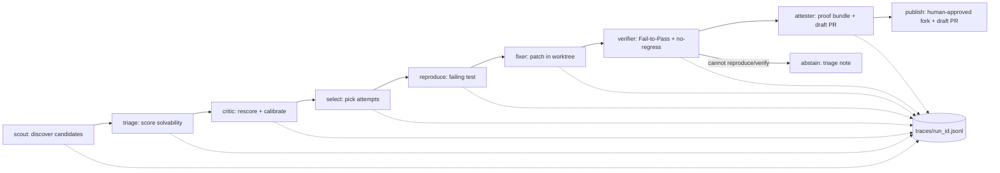

# ISSA AS — Architecture

## 1. Pitch

Open-source maintainers drown in bug reports while contributors struggle to find issues they can actually fix.
ISSA AS is an agentic solver that scouts public GitHub bug issues, predicts which are solvable, reproduces one as a
failing test, fixes it in isolation, and proves the fix deterministically (Fail-to-Pass with no regressions) —
or abstains honestly with an evidence-based triage note when it cannot.
Every step is logged to a JSONL trace with token costs, and a static viewer replays committed traces with no API
keys, so judges and maintainers can audit each claim.
Post-hackathon it becomes a maintainer-side triage bot and a contributor-side "first good fix" finder, cutting
triage toil and raising the share of issues that arrive with a reproduction instead of just a complaint.

## 2. Pipeline



| Stage | Responsibility |
|---|---|
| `scout` | Query GitHub issues (label `bug`, has code snippet, pure-Python + pytest repo, small suite); emit 20–30 candidates with metadata. No LLM. |
| `triage` | Score each candidate 0–1 for solvability with rationale (reproducibility, scope, test presence, dependency risk). Pluggable provider: Spark Open when credentials exist, else Spark 1.3. |
| `critic` | Independent rescore of top candidates; flags overconfidence; feeds calibration data. Load-bearing Spark Open stage #2. |
| `select` | Rank by calibrated score ÷ estimated cost under per-issue caps; record why each issue was attempted or skipped. Deterministic. |
| `reproduce` | Clone repo to `workspaces/<run>/`, create isolated git worktree at base commit, write a minimal failing test. Success = test fails on base for the right reason. |
| `fixer` | Run `muse exec --worktree create --output-schema ...` with effort from triage difficulty; output a structured patch + explanation. Only stage with a write-capable agent. |
| `verifier` | Deterministic plain-Python gate: new test FAILS on base, PASSES after patch, pre-existing suite does not regress. No LLM. |
| `attester` | Assemble proof bundle (failing test, patch, logs, cost ledger) + draft PR text. On failure, write an evidence-based triage note instead (honest abstention). |
| `publish` | Explicit human-approved command only: fork + draft PR. Default is dry-run; never runs automatically. |

## 3. Module layout (`src/issa_as/`)

```text
src/issa_as/
  scout.py      # discovery      triage.py    # scoring (pluggable provider)
  critic.py     # rescore        select.py    # ranking under caps
  reproduce.py  # failing test   fixer.py     # muse exec wrapper
  verifier.py   # F2P gate       attester.py  # bundles + notes
  budget.py     # caps + ledger  traces.py    # JSONL append/read
  providers.py  # model routing  publish.py   # gated fork + draft PR
  cli.py        # run/replay/publish commands
```

```python
# scout.py
def discover(query: str, limit: int = 30) -> list[Candidate]: ...
# triage.py
def score(candidates: list[Candidate], provider: TriageProvider) -> list[ScoredIssue]: ...
# critic.py
def rescore(scored: list[ScoredIssue], provider: TriageProvider) -> list[ScoredIssue]: ...
# select.py
def pick(scored: list[ScoredIssue], caps: IssueCaps) -> Selection: ...
# reproduce.py
def reproduce(issue: ScoredIssue, workdir: Path) -> ReproResult: ...
# fixer.py
def fix(issue: ScoredIssue, repro: ReproResult, effort: str, schema: dict) -> FixResult: ...
# verifier.py
def verify(base: Commit, patch: Patch, test: Path, suite: SuiteCmd) -> Verdict: ...
def check_no_regressions(before: TestReport, after: TestReport) -> bool: ...
# attester.py
def bundle(issue: ScoredIssue, fix: FixResult, verdict: Verdict, costs: Ledger) -> ProofBundle: ...
def triage_note(issue: ScoredIssue, evidence: Evidence) -> TriageNote: ...
# budget.py
def check_and_charge(ledger: Ledger, usage: TokenUsage, caps: IssueCaps) -> None: ...
# traces.py
def append(run_id: str, event: Event) -> None: ...
def load(run_id: str) -> list[Event]: ...
# providers.py
def triage_provider() -> TriageProvider: ...
def complete(stage: str, prompt: str, effort: str) -> Completion: ...
# publish.py
def publish(bundle: ProofBundle, approval: Approval) -> PublishResult: ...
# cli.py
def main(argv: list[str] | None = None) -> int: ...
```

`verifier.py`, `select.py`, `budget.py` are pure deterministic Python (no LLM calls).

## 4. Trace event schema (`traces/<run_id>.jsonl`, one JSON object per line)

Common fields: `run_id, seq, ts, stage, issue_id`.
Stage-specific fields:

| Event `type` | Key fields |
|---|---|
| `run_started` | `run_id, config_hash, model_routes, caps` |
| `issue_discovered` | `issue_url, repo, labels, has_snippet` |
| `triage_scored` | `solvability, rationale, difficulty, provider, model` |
| `critic_rescored` | `solvability_v2, delta, flag, provider, model` |
| `selected` / `skipped` | `reason, est_cost_usd` |
| `repro_result` | `test_path, failed_on_base: bool, failure_reason` |
| `fix_attempt` | `effort, patch_hash, explanation` |
| `verify_verdict` | `f2p_pass: bool, regressions: int, log_ref` |
| `abstained` | `note_ref, evidence_refs` |
| `proof_bundle` | `bundle_path, test_ref, patch_ref, total_cost_usd` |
| `model_call` | `stage, model, provider, in_tokens, out_tokens, cost_usd` |
| `cap_blocked` | `cap (steps/time/usd), spent` |
| `publish_dryrun` / `published` | `pr_text_ref, fork_url?, approval_id` |

The HTML viewer and Keyless Trace Replay read only these files; replays ship with `model_call` costs baked in.

## 5. Model routing

Pricing: Spark 1.3 `$1.25` in / `$4.25` out per 1M; contributor `$0.10` / `$0.20` per 1M.

| Stage | Model | Effort | Why | Est. cost/issue |
|---|---|---|---|---|
| triage (primary) | Spark Open via hosted provider; fallback Spark 1.3 | low | Cheap first pass; Open weights = bonus path | ~$0.01 |
| critic | Spark Open (fallback 1.3) | medium | Independent judgment catches triage overconfidence; load-bearing Open stage | ~$0.02 |
| reproduce assist | contributor | medium | Needs code reading, not frontier reasoning | ~$0.02 |
| fixer | Spark 1.3 via `muse exec` | effort ← triage difficulty (low/med/high) | Hardest task gets the strongest model | $0.10–0.50 |
| patch critic | Spark Open (fallback 1.3) | low | Cheap second opinion on the diff before verify | ~$0.01 |
| verifier/attester math | none (plain Python) | — | Determinism must not depend on an LLM | $0 |

Ablation: same issues scored/fixed under (Spark Open vs Spark 1.3 vs contributor) triage; report verified-fix rate and calibration per arm. Typical full attempt ≈ **$0.20–0.60**; with ~$30 of the $150 budget for the demo benchmark, that funds 50–100 attempts.

## 6. Safety model

- **Filesystem:** target repos are cloned under `workspaces/<run>/` only; fixer runs in an isolated git worktree; our own repo is never the agent's workdir. Paths are validated to stay inside `workspaces/` before any write.
- **Network:** runtime network is limited to GitHub API/clone + the configured model endpoints. No arbitrary browsing or package installs from the agent.
- **GitHub write gate:** default is dry-run. The only write path is an explicit human-approved `publish` command (fork + draft PR, requires an `approval_id` tied to a reviewed proof bundle). `AGENTS.md` further forbids pushes/`gh` writes from automation.
- **Secrets:** keys only via env (`MODEL_API_KEY`, optional hosted-provider key, `GITHUB_TOKEN` for publish); `.env` is git-ignored and never logged; traces record token counts and USD, never key material.

## 7. Build plan (one prompt per module)

| # | Module | Time | Test that proves it |
|---|---|---|---|
| 1 | `traces.py` + event schema | 2 h | Append 100 events, reload, assert order + required fields |
| 2 | `budget.py` (caps + ledger) | 2 h | Simulated over-cap run raises `cap_blocked` before spend |
| 3 | `providers.py` + `triage.py` | 3 h | Same 5 fixtures score sensibly on Spark Open and fallback 1.3 |
| 4 | `scout.py` | 2 h | Returns 20–30 candidates meeting the filter on a live query |
| 5 | `critic.py` + `select.py` | 2 h | Overconfident fixture is downscored; ranking respects caps |
| 6 | `reproduce.py` | 4 h | Known bug yields a test that fails on base for the right reason |
| 7 | `fixer.py` (`muse exec` wrapper) | 3 h | Structured patch output parses against `--output-schema` |
| 8 | `verifier.py` (F2P + no-regress) | 3 h | Passes a real fix; rejects a fake fix and a regressing patch |
| 9 | `attester.py` + viewer + replay | 4 h | Bundle renders in the viewer with no keys; replay matches live |
| 10 | `publish.py` (dry-run default) | 2 h | Dry-run writes PR text without any network mutation |
| 11 | Benchmark + ablation report | 4 h | Table of fix rate, abstention accuracy, calibration, cost/fix |

Total ≈ 31 h implementation + buffer for demo polish, inside the ~50 h window.

## 8. Top risks and mitigations

- **Flaky or slow target suites break "deterministic" claims.** Mitigation: cap suite size at scout time; run the F2P test in isolation plus a bounded regression subset; record wall time in the trace. Cut: full-suite guarantees.
- **Reproduction fails more often than the demo needs.** Mitigation: abstention is a first-class metric (abstention accuracy), not a failure; triage difficulty routes effort so easy wins come first. Cut: multi-round fixer retries beyond one retry.
- **Spark Open credentials/hosting fall through.** Mitigation: provider interface falls back to Spark 1.3 automatically and every event logs which provider actually ran — the ablation degrades to 1.3-vs-contributor rather than blocking the demo.
- **`muse exec` worktree behavior differs on Windows.** Mitigation: wrap it in `fixer.py` early (step 7) so breakage surfaces with time to fall back to in-process patching inside `workspaces/`.
- **Budget overrun across runs.** Mitigation: per-issue step/time/USD caps enforced in `budget.py` and checked before each model call; ledger is part of the proof bundle.
- **Demo smoke:** live end-to-end on an unseen repo is not promised. We demo one live fix plus Keyless Replay of committed traces — replay, not luck.

## Summary

- Scout → triage → critic → select → reproduce → fix → verify → attest, with honest abstention.
- Deterministic verifier and budget ledger are plain Python; LLMs only propose.
- Spark Open is load-bearing (triage + patch critic) behind a pluggable provider with Spark 1.3 fallback.
- Every stage emits JSONL; judges replay committed traces with no keys.
- Demo promises one live fix plus replay, never an unseen-repo miracle.
