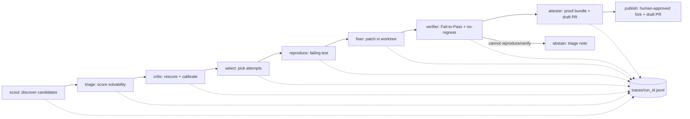

# ISSA AS — Architecture

> **Implementation status (2026-11-03).** This document is the original design written by Muse Code from Prompt 01;
> sections 3, 5 and 7 are the plan. What was actually built:
>
> | Planned | Built as |
> |---|---|
> | `reproduce.py` + `fixer.py` | `solver.py` (one `muse exec` session, test commit then fix commit) |
> | `attester.py` | `pipeline.py` (proof bundles, abstention notes) and `bundle.py` (`issa verify-bundle`) |
> | `publish.py` | `issa publish` in `cli.py`, dry-run only |
> | viewer | `serve.py` + `web/` (local panel) and the public page at issasodaweb.com/issaas |
> | — | `workspace.py` (clone, venv, test dependencies), `run.py` (`issa run`), `signals.py`, `ratelimit.py` |
>
> Not built: the patch critic and the triage ablation (section 5), the benchmark milestone (section 7). Solver steps
> come from the per-issue USD cap, not from triage difficulty. The live record is `docs/AUDIT_LOG.md`.

## 1. Pitch

Open-source maintainers drown in bug reports while contributors struggle to find issues they can actually fix.
ISSA AS is an agentic solver that scouts public GitHub bug issues, predicts which are solvable, reproduces one as a
failing test, fixes it in isolation, and proves the fix deterministically (Fail-to-Pass with no regressions) —
or abstains honestly with an evidence-based triage note when it cannot.
Every step is logged to a JSONL trace with token costs, and a static viewer replays committed traces with no API
keys, so judges and maintainers can audit each claim.
Post-hackathon it becomes a maintainer-side triage bot and a contributor-side "first good fix" finder, cutting
triage toil and raising the share of issues that arrive with a reproduction instead of just a complaint.

## 2. Pipeline



| Stage | Responsibility |
|---|---|
| `scout` | Query GitHub issues (label `bug`, has code snippet, pure-Python + pytest repo, small suite); apply the reputation filter (min stars, not archived, recent commit activity); emit 20–30 candidates with metadata. No LLM. |
| `triage` | Score each candidate 0–1 for solvability with rationale (reproducibility, scope, test presence, dependency risk). Pluggable provider: Spark Open when credentials exist, else Spark 1.3. |
| `critic` | Independent rescore of top candidates; flags overconfidence; feeds calibration data. Load-bearing Spark Open stage #2. |
| `select` | Rank by calibrated score ÷ estimated cost under per-issue caps; record why each issue was attempted or skipped. Deterministic. Escalated picks (`muse-spark-1.3` + `high` effort) carry `recommended_max_usd` 2.00, everything else 0.60; `issa run` and the local panel (`serve.py` + `web/`) use it as the solver allowance. |
| `reproduce` + `fixer` | One `muse exec` session with two checkpoints: (1) write a minimal failing test and stop — checkpoint fails unless the test fails on base for the right reason; (2) resume in the same session (repo context kept) to produce a structured patch + explanation. Exact runtime flags below. Only stage with a write-capable agent. |
| `verifier` | Deterministic plain-Python gate: new test FAILS on base, PASSES after patch, pre-existing suite does not regress. No LLM. |
| `attester` | Assemble proof bundle (failing test, patch, logs, cost ledger) + draft PR text. On failure, write an evidence-based triage note instead (honest abstention). |
| `publish` | Explicit human-approved command only: fork + draft PR. Default is dry-run; never runs automatically. |

## 3. Module layout (`src/issa_as/`)

```text
src/issa_as/
  scout.py      # discovery      triage.py    # scoring (pluggable provider)
  critic.py     # rescore        select.py    # ranking under caps
  reproduce.py  # failing test   fixer.py     # muse exec wrapper
  verifier.py   # F2P gate       attester.py  # bundles + notes
  budget.py     # caps + ledger  traces.py    # JSONL append/read
  providers.py  # model routing  publish.py   # gated fork + draft PR
  cli.py        # run/replay/publish commands
```

```python
# scout.py
def discover(query: str, limit: int = 30) -> list[Candidate]: ...
# triage.py
def score(candidates: list[Candidate], provider: TriageProvider) -> list[ScoredIssue]: ...
# critic.py
def rescore(scored: list[ScoredIssue], provider: TriageProvider) -> list[ScoredIssue]: ...
# select.py
def pick(scored: list[ScoredIssue], caps: IssueCaps) -> Selection: ...
# reproduce.py
def reproduce(issue: ScoredIssue, workdir: Path) -> ReproResult: ...
# fixer.py
def fix(issue: ScoredIssue, repro: ReproResult, effort: str, schema: dict) -> FixResult: ...
# verifier.py
def verify(base: Commit, patch: Patch, test: Path, suite: SuiteCmd) -> Verdict: ...
def check_no_regressions(before: TestReport, after: TestReport) -> bool: ...
# attester.py
def bundle(issue: ScoredIssue, fix: FixResult, verdict: Verdict, costs: Ledger) -> ProofBundle: ...
def triage_note(issue: ScoredIssue, evidence: Evidence) -> TriageNote: ...
# budget.py
def check_and_charge(ledger: Ledger, usage: TokenUsage, caps: IssueCaps) -> None: ...
# traces.py
def append(run_id: str, event: Event) -> None: ...
def load(run_id: str) -> list[Event]: ...
# providers.py
def triage_provider() -> TriageProvider: ...
def complete(stage: str, prompt: str, effort: str) -> Completion: ...
# publish.py
def publish(bundle: ProofBundle, approval: Approval) -> PublishResult: ...
# cli.py
def main(argv: list[str] | None = None) -> int: ...
```

`verifier.py`, `select.py`, `budget.py` are pure deterministic Python (no LLM calls).

Fixer runtime (`fixer.py` builds exactly this invocation; repo is cloned to `workspaces/<run>/<repo>` and the
worktree is created inside `workspaces/`):

```text
muse exec --workspace workspaces/<run>/<repo> --disable-web-tools --max-model-steps <N>
  --output-schema fixer_schema.json --json "<prompt: reproduce, then fix>"
```

Sandbox is on, network is limited to GitHub + the configured model endpoints, and `<N>` comes from triage
difficulty (low/med/high). Checkpoint 1 returns the failing test; checkpoint 2 returns the patch. The
verifier re-checks both independently (test fails on base, passes after patch).

## 4. Trace event schema (`traces/<run_id>.jsonl`, one JSON object per line)

Common fields: `run_id, seq, ts, stage, issue_id`.
Stage-specific fields:

| Event `type` | Key fields |
|---|---|
| `run_started` | `run_id, config_hash, model_routes, caps` |
| `issue_discovered` | `issue_url, repo, labels, has_snippet` |
| `triage_scored` | `solvability, rationale, difficulty, provider, model` |
| `critic_rescored` | `solvability_v2, delta, flag, provider, model` |
| `selected` / `skipped` | `reason, est_cost_usd` |
| `repro_result` | `test_path, failed_on_base: bool, failure_reason` |
| `fix_attempt` | `effort, patch_hash, explanation` |
| `verify_verdict` | `f2p_pass: bool, regressions: int, log_ref` |
| `abstained` | `note_ref, evidence_refs` |
| `proof_bundle` | `bundle_path, test_ref, patch_ref, total_cost_usd` |
| `model_call` | `stage, model, provider, in_tokens, out_tokens, cost_usd` |
| `cap_blocked` | `cap (steps/time/usd), spent` |
| `publish_dryrun` / `published` | `pr_text_ref, fork_url?, approval_id` |

The HTML viewer and Keyless Trace Replay read only these files; replays ship with `model_call` costs baked in.

## 5. Model routing

Pricing: Spark 1.3 `$1.25` in / `$4.25` out per 1M; contributor `$0.10` / `$0.20` per 1M.

| Stage | Model | Effort | Why | Est. cost/issue |
|---|---|---|---|---|
| triage (primary) | Spark Open via hosted provider; fallback Spark 1.3 | low | Cheap first pass; Open weights = bonus path | ~$0.01 |
| critic | Spark Open (fallback 1.3) | medium | Independent judgment catches triage overconfidence; load-bearing Open stage | ~$0.02 |
| reproduce (checkpoint 1) + fixer (checkpoint 2) | Spark 1.3 via `muse exec` (exact flags in §3) | effort ← triage difficulty (low/med/high) | One session keeps repo context; hardest task gets the strongest model | $0.10–0.50 |
| patch critic | Spark Open (fallback 1.3) | low | Cheap second opinion on the diff before verify | ~$0.01 |
| verifier/attester math | none (plain Python) | — | Determinism must not depend on an LLM | $0 |

Ablation covers triage/critic arms only (Spark Open vs Spark 1.3 vs contributor scoring the same
issues); report verified-fix rate and calibration per arm. The fixer is fixed to one model (Spark 1.3) plus a single
low-vs-high effort comparison. Typical full attempt ≈ **$0.20–0.60**; with ~$30 of the $150 budget for the demo
benchmark, that funds 50–100 attempts.

## 6. Safety model (untrusted code runs on the host)

- **Reputation filter (scout time):** only repos above a star floor, not archived, with recent commit activity, pure-Python + pytest, and a small suite. Anything else never reaches execution.
- **Filesystem:** target repos are cloned under `workspaces/<run>/` only; fixer runs in an isolated git worktree inside `workspaces/`; our own repo is never the agent's workdir. Paths are validated to stay inside `workspaces/` before any write.
- **Test subprocesses:** run with cwd pinned under `workspaces/<run>/`, `TMP`/`TEMP` pinned there too, a sanitized environment (no secrets, no API keys inherited), hard timeouts on every command, and the Muse OS sandbox where possible.
- **Solver flags:** the fixer passes `--model`, `--reasoning-effort` and `--approval-mode never` (sandbox stays on), and deliberately omits `--trust-workspace`, so a target repo's own agent rules and skills cannot steer the solver (prompt-injection defense).
- **Known risk: dependency install runs third-party build code outside the OS sandbox.** `uv pip install` executes the target repo's build backends and install scripts on the host. Mitigations: install only from reputation-filtered repos, run installs with the same sanitized env and hard timeouts as the verifier (no secrets, temp dirs pinned under `workspaces/<run>/`), and copy the full install log into the proof bundle (`install.log`) so every executed install is auditable.
- **Network:** runtime network is limited to GitHub API/clone + the configured model endpoints. No arbitrary browsing or package installs from the agent.
- **GitHub write gate:** default is dry-run. The only write path is an explicit human-approved `publish` command (fork + draft PR, requires an `approval_id` tied to a reviewed proof bundle). `AGENTS.md` further forbids pushes/`gh` writes from automation.
- **Secrets:** keys only via env (`MODEL_API_KEY`, optional hosted-provider key, `GITHUB_TOKEN` for publish); `.env` is git-ignored and never logged; traces record token counts and USD, never key material.

## 7. Build plan (milestones, thin slice first)

| Milestone | Scope | Exit test |
|---|---|---|
| 1. Foundation | `traces.py`, `budget.py`, `providers.py`, `cli.py` stubs, `.env.example` | `uv run pytest` + `uv run ruff check` pass; no real API calls in tests |
| 2. Vertical slice | ONE known issue end-to-end: scout → triage → reproduce+fix (one session, two checkpoints) → verifier F2P → trace → viewer renders it | Failing test fails on base for the right reason, passes after patch, no regressions; trace replays keyless |
| 3. Scout/triage/critic breadth | `scout.py` with reputation filter, `triage.py`, `critic.py`, `select.py` on 20–30 candidates | Live query returns 20–30 filtered candidates; overconfident fixture downscored; ranking respects caps |
| 4. Benchmark + ablation | Verified-fix rate, abstention accuracy, calibration, cost/fix; ablation on triage/critic arms only, fixer fixed to one model + one effort comparison | Report table reproduces from committed traces |
| 5. Viewer polish + README | Keyless Trace Replay, proof-bundle rendering, README demo path | Cold run: one live fix + replay with no keys |

One `muse exec` session covers reproduce + fixer (two checkpoints); the verifier re-checks both independently.

## 8. Top risks and mitigations

- **Flaky or slow target suites break "deterministic" claims.** Mitigation: cap suite size at scout time; run the F2P test in isolation plus a bounded regression subset; record wall time in the trace. Cut: full-suite guarantees.
- **Reproduction fails more often than the demo needs.** Mitigation: abstention is a first-class metric (abstention accuracy), not a failure; triage difficulty routes effort so easy wins come first. Cut: multi-round fixer retries beyond one retry.
- **Spark Open credentials/hosting fall through.** Mitigation: provider interface falls back to Spark 1.3 automatically and every event logs which provider actually ran — the ablation degrades to 1.3-vs-contributor rather than blocking the demo.
- **`muse exec` worktree behavior differs on Windows.** Mitigation: wrap it in `fixer.py` early (Milestone 2 vertical slice) so breakage surfaces with time to fall back to in-process patching inside `workspaces/`.
- **Budget overrun across runs.** Mitigation: per-issue step/time/USD caps enforced in `budget.py` and checked before each model call; ledger is part of the proof bundle.
- **Demo smoke:** live end-to-end on an unseen repo is not promised. We demo one live fix plus Keyless Replay of committed traces — replay, not luck.

## Summary

- Scout → triage → critic → select → reproduce+fix (one session, two checkpoints) → verify → attest, with honest abstention.
- Deterministic verifier and budget ledger are plain Python; LLMs only propose.
- Spark Open is load-bearing (triage + critic) behind a pluggable provider with Spark 1.3 fallback.
- Every stage emits JSONL; judges replay committed traces with no keys.
- Demo promises one live fix plus replay, never an unseen-repo miracle.
